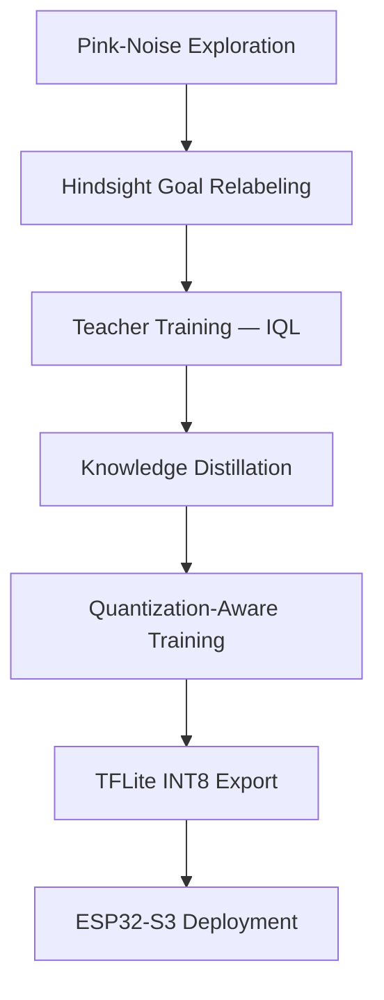

# TinyNav — How to Run

End-to-end guide from wiring the robot to autonomous image-goal navigation on ESP32-S3.

---

## Pipeline Overview



| Stage | What happens |
|---|---|
| **Exploration** | Robot drives autonomously using temporally correlated pink noise. APDS9960 proximity sensor triggers obstacle avoidance. Raw frames, actions, headings, and proximity are logged. |
| **Relabeling** | Future frames are retroactively labeled as goals. Transforms aimless exploration into a goal-conditioned RL dataset without human annotation. |
| **Teacher training** | A 24M-parameter model (ResNet encoder + learned pyramid correlation + IQL value heads) learns a navigation policy from the offline dataset. |
| **Distillation** | A 4M-parameter student (depthwise-separable encoder + parameterless dot-product correlation) is trained to match the teacher's action distributions and correlation cues. |
| **QAT** | Fake INT8 quantization nodes are inserted during fine-tuning so the student learns to compensate for rounding errors. |
| **Export** | The quantized student is split into encoder and policy TFLite models and converted to C header arrays. |
| **Deployment** | Models are flashed to ESP32-S3. Inference runs at 5 Hz entirely on-device with no cloud connectivity. |

For full architectural details, loss formulations, and compression analysis, see the [technical report](./technical_report.pdf).

---

## Prerequisites

### Hardware

| Part | Specification |
|---|---|
| ESP32-S3 | PSRAM-equipped dev board (e.g. Freenove ESP32-S3) |
| Camera | OV3660 3MP 160° fisheye, 24-pin |
| Motor driver | DRV8833 dual H-bridge |
| Motors | 2× DC gear motors (differential drive) |
| IMU board | Arduino Nano 33 BLE Sense Rev2 (BMI270 + BMM150 + APDS9960) |
| Power | 8V battery for Arduino VIN, USB or LiPo for ESP32 |

### Software

| Tool | Version |
|---|---|
| ESP-IDF | v5.x |
| Arduino IDE | 2.x (for Nano 33 BLE Sense Rev2) |
| Python | 3.9+ |
| PyTorch | 2.x (GPU recommended for training) |
| TensorFlow | 2.x (TFLite conversion only) |

---

## Step 0: Wiring

### 0.1 ESP32-S3 connections

All pin assignments are in `firmware/esp32/main/include/config.h`.

**Camera (OV3660)**

| Signal | GPIO |
|---|---|
| XCLK | 15 |
| SIOD/SIOC | 4, 5 |
| D0-D7 | 11, 9, 8, 10, 12, 18, 17, 16 |
| VSYNC/HREF/PCLK | 6, 7, 13 |

**Motors (DRV8833)**

| Signal | GPIO |
|---|---|
| IN1-IN4 | 38, 39, 40, 41 |
| ENA/ENB | 42, 14 |

**Arduino UART (IMU + proximity)**

| Signal | GPIO |
|---|---|
| UART RX (from Arduino TX) | 19 |
| UART TX (to Arduino RX) | 21 |
| GND | GND (shared with Arduino GND) |

### 0.2 Arduino Nano 33 BLE Sense Rev2

The Arduino runs the `imu_heading.ino` sketch. It reads the BMI270 gyroscope, BMM150 magnetometer, and APDS9960 proximity sensor, then sends fused heading and proximity over Serial1 (UART) at 50 Hz.

Connect Arduino TX1 to ESP32 GPIO 19 and share GND between both boards.

Power the Arduino from 8V battery on VIN. The onboard regulator steps it to 3.3V.

---

## Step 1: Flash the Arduino

Open `firmware/arduino/imu_heading/imu_heading.ino` in Arduino IDE.

Install these libraries via Library Manager:
- `Arduino_BMI270_BMM150`
- `Arduino_APDS9960`

Select board "Arduino Nano 33 BLE" and upload.

Verify on Serial Monitor (115200 baud):
```
IMU + Proximity ready
Gyro sample rate: 104.00
Magnetometer: YES
APDS9960: YES
Heading: 45.32  Proximity: 255
Heading: 45.30  Proximity: 248
```

Proximity values: 0 = very close, 255 = nothing detected.

---

## Step 2: Build and Flash the ESP32

### 2.1 Set WiFi credentials

Edit `firmware/esp32/main/include/config.h` or run `idf.py menuconfig`.

### 2.2 Build and flash

```bash
cd firmware/esp32
idf.py set-target esp32s3
idf.py build
idf.py -p /dev/ttyUSB0 flash monitor
```

On first boot without models, the firmware enters collection mode automatically:
```
║   ImageNav — Single Board             ║
[1/5] Initializing camera...
[2/5] Initializing motors...
[3/5] Initializing IMU UART...
[4/5] Proximity sensor active via Arduino UART
[5/5] Connecting to WiFi...
No policy model — COLLECTION mode
Starting explorer...
```

Note the IP address printed after WiFi connects.

---

## Step 3: Validate Hardware

On your laptop:

```bash
cd python
pip install -r requirements.txt
```

Edit `receiver.py` and set `ESP32_HOST` to the IP from Step 2.

```bash
python3 receiver.py
```

You should see live camera frames and sensor readings. Press `q` to quit.

---

## Step 4: Collect Exploration Data

Edit `python/explorer.py`:

```python
ESP32_HOST          = "192.168.1.100"
OUTPUT_DIR          = "./data/session_01"
DURATION_SEC        = 1800
RATE_HZ             = 5.0
BETA                = 1.0
SEED                = 42
```

Run:

```bash
python3 explorer.py
```

The robot drives autonomously using pink-noise actions with proximity-based obstacle avoidance. The Arduino provides heading and proximity readings over UART.

Run 3-5 sessions with different `SEED` and `OUTPUT_DIR` values. Vary lighting and starting position.

### 4.1 Merge sessions

Edit `python/merge_sessions.py` with your session paths, then:

```bash
python3 merge_sessions.py
```

---

## Step 5: Build Offline RL Dataset

Edit `python/hindsight_relabel.py`:

```python
MERGED_DIR  = "./data/merged"
OUTPUT_DIR  = "./data/offline_dataset"
NUM_RELABELS = 5
```

```bash
python3 hindsight_relabel.py
```

---

## Step 6: Train Teacher Model (GPU)

Edit `python/train_teacher.py`:

```python
DATASET_DIR     = "./data/offline_dataset"
CHECKPOINT_DIR  = "./checkpoints/teacher"
TOTAL_STEPS     = 200_000
BATCH_SIZE      = 256
```

```bash
python3 train_teacher.py
```

Teacher architecture: ResNet encoder (21.25M) + learned pyramid correlation (2.20M) + IQL policy/value heads (0.67M) = 24.13M total parameters.

Best checkpoint saved to `checkpoints/teacher/best.pt`.

---

## Step 7: Distill to Student Model

Edit `python/distill.py`:

```python
DATASET_DIR     = "./data/offline_dataset"
TEACHER_CKPT    = "./checkpoints/teacher/best.pt"
CHECKPOINT_DIR  = "./checkpoints/student"
TOTAL_STEPS     = 100_000
```

```bash
python3 distill.py
```

Student architecture: depthwise-separable encoder (3.77M) + parameterless dot-product correlation (0) + MLP policy (0.30M) = 4.07M deployable parameters. 5.9x compression from teacher.

Dual-level distillation: KL divergence on action distributions + MSE on projected correlation cues + hard label cross-entropy.

Target: >90% action agreement with teacher.

---

## Step 8: Quantize and Export

Edit `python/quantize_export.py`:

```python
STUDENT_CKPT    = "./checkpoints/student/best.pt"
TEACHER_CKPT    = "./checkpoints/teacher/best.pt"
OUTPUT_DIR      = "./export"
QAT_STEPS       = 10_000
```

```bash
python3 quantize_export.py
```

Produces INT8 TFLite models and C header arrays in `export/esp32_headers/`.

---

## Step 9: Deploy to ESP32

### 9.1 Copy model headers

```bash
cp export/esp32_headers/encoder_model.h firmware/esp32/main/include/
cp export/esp32_headers/policy_model.h  firmware/esp32/main/include/
```

### 9.2 Enable model includes

Edit `firmware/esp32/main/inference.cpp`. Uncomment the real model includes and delete the placeholder arrays.

### 9.3 Rebuild and flash

```bash
cd firmware/esp32
idf.py build
idf.py -p /dev/ttyUSB0 flash monitor
```

The firmware detects the loaded models and enters navigation mode automatically.

### 9.4 Navigate

1. The robot boots and waits for goal capture
2. Carry the robot to the target location and press the goal button
3. The robot encodes the goal image and caches the features in PSRAM
4. Carry the robot to a starting position
5. The robot navigates autonomously at 5 Hz

---

## Evaluation

Evaluation scripts are in `python/eval/`. Edit the config constants at the top of each file.

```bash
cd python

python3 -m eval.compression_metrics
python3 -m eval.distillation_quality
python3 -m eval.qat_degradation
python3 -m eval.visualize_correlation
```

---

## Project Structure

```
3d-obj-detection/
├── firmware/
│   ├── esp32/                          ESP-IDF firmware
│   │   └── main/
│   │       ├── include/
│   │       │   ├── config.h            Pin assignments, timing, thresholds
│   │       │   ├── camera.h
│   │       │   ├── motor.h
│   │       │   ├── imu_uart.h
│   │       │   ├── explorer.h
│   │       │   ├── navigator.h
│   │       │   ├── inference.h
│   │       │   ├── image_proc.h
│   │       │   └── wifi_stream.h
│   │       ├── main.c                  Boot: auto-selects collection or navigation
│   │       ├── camera.c                OV3660 JPEG capture
│   │       ├── motor.c                 DRV8833 differential drive
│   │       ├── imu_uart.c              Arduino UART parser (heading + proximity)
│   │       ├── explorer.c              Pink-noise step-and-stop exploration
│   │       ├── navigator.c             Goal-conditioned navigation loop
│   │       ├── inference.cpp           TFLite Micro encoder + policy inference
│   │       ├── image_proc.c            JPEG decode and resize to 96×96
│   │       └── wifi_stream.c           TCP server for laptop data streaming
│   └── arduino/
│       └── imu_heading/
│           └── imu_heading.ino         BMI270+BMM150 heading + APDS9960 proximity
│
├── python/
│   ├── requirements.txt
│   ├── receiver.py                     Live frame viewer
│   ├── pink_noise.py                   1/f noise generator (Voss-McCartney)
│   ├── explorer.py                     Autonomous data collection client
│   ├── merge_sessions.py               Combine multiple sessions
│   ├── validate_session.py             Session integrity checks
│   ├── hindsight_relabel.py            Goal relabeling → offline RL dataset
│   ├── dataset.py                      PyTorch Dataset + DataLoader
│   ├── models.py                       Teacher: ResNet + correlation + IQL
│   ├── train_teacher.py                IQL offline RL training
│   ├── student_model.py                Student: DSConv + dot-product correlation
│   ├── distill.py                      Knowledge distillation
│   ├── quantize_export.py              QAT + TFLite INT8 + C header export
│   ├── run_pipeline.py                 End-to-end pipeline runner
│   └── eval/
│       ├── compression_metrics.py      Params, MACs, model sizes
│       ├── distillation_quality.py     Action agreement, KL div, correlation MSE
│       ├── qat_degradation.py          FP32 → QAT → INT8 degradation
│       └── visualize_correlation.py    Correlation heatmaps
│
├── tests/
│   └── test_server.py                  TCP server integration tests
│
└── report/
    ├── main.tex
    ├── introduction.tex
    ├── background.tex
    ├── method.tex
    ├── results.tex
    ├── discussion.tex
    └── references.bib
```

---

## Troubleshooting

| Issue | Fix |
|---|---|
| Camera init fails (0x105) | Check PSRAM is enabled in sdkconfig. Verify all 16 camera pin assignments in config.h. |
| No WiFi connection | Check SSID/password. Ensure 2.4 GHz network (ESP32 does not support 5 GHz). |
| Motor does not spin | Verify DRV8833 wiring (IN1-4 + ENA/ENB). Check motor power is separate from ESP32. |
| Arduino data not received | Verify GND is shared between Arduino and ESP32. Check UART TX/RX pins. |
| Proximity always 255 | Check APDS9960 initialization on Arduino Serial Monitor. Sensor may not detect objects beyond 10 cm. |
| TFLite arena allocation fails | Reduce arena size or ensure PSRAM is enabled. |
| Low distillation agreement (<85%) | Collect more data, increase training steps, or tune distillation loss weights. |
| Robot oscillates near goal | Tune STEP_BURST_MS and TURN_45_MS in config.h. |
